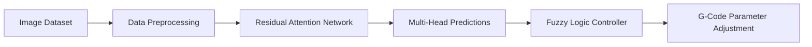
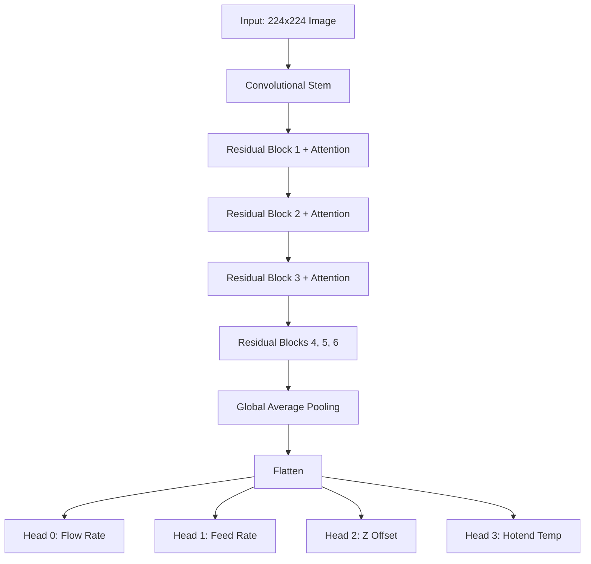

# FDM 3D Printing Quality Monitoring and Control via Residual Attention Network

## 1. Project Overview
This repository contains the source code for an automated 3D printing quality monitoring and process control system for Fused Deposition Modeling (FDM) printers[cite: 4]. The system leverages a Deep Learning computer vision pipeline to analyze real-time extrusion morphology and a Fuzzy Logic controller to dynamically adjust printing parameters[cite: 3, 4]. 

**Problem Statement:** Print quality in FDM is highly sensitive to parameter imbalances (e.g., flow rate, lateral feed rate, Z-offset, hotend temperature)[cite: 3]. Manual tuning is inefficient, error-prone, and lacks real-time adaptability[cite: 4].
**Technical Objective:** To establish a closed-loop control system that predicts the deviation of four primary printing parameters from their optimal states using single-frame images, and automatically compensates for these deviations using confidence-weighted fuzzy logic[cite: 3, 4].



## 2. Research Objectives and Scope

* **Automated Evaluation:** Replace manual trial-and-error by predicting parameter deviations (Very Low, Low, Good, High, Too High) directly from visual extrusion characteristics.


* **Closed-Loop Correction:** Apply bounded, confidence-aware parameter adjustments in real-time to stabilize the printing process.


* **Scope Limitations:** The baseline model infers parameter deviations based on observed morphology; it does not deterministically measure the physical geometry of the extrusion or isolate complex mechanical failures (e.g., axis binding, bed leveling anomalies) that may produce similar visual artifacts.


## 3. System Architecture

The software architecture bridges a PyTorch Lightning-based Deep Learning framework with a Sugeno-type Fuzzy Inference System.

* **Data Pipeline:** Crops regions of interest (ROI) around the nozzle tip, resizes to 224x224, and applies normalization.


* **Model Architecture:** A Residual Attention Network-56 acts as the shared feature extractor. The network employs trunk branches for residual feature learning and mask branches for spatial attention modulation, enhancing salient filament regions while suppressing background noise.


* **Prediction Heads:** Four independent fully connected heads output logits for Flow Rate, Feed Rate, Z-Offset, and Hotend Temperature.


* **Fuzzy Controller:** Aggregates predictions over a temporal window to calculate a "Confidence" score (0.0 to 1.0) based on majority voting. This confidence, paired with the predicted class, determines the final adjustment gain ($\Delta P$).




## 4. Repository Structure

```text
RESEARCH/
├── data/                  # PyTorch Lightning DataModules and Dataset definitions
├── fuzzy/                 # Fuzzy logic inference system, rules, and membership functions
├── lightning_logs/        # TensorBoard logs, hparams, and model checkpoints
├── logs/                  # Experimental logs and inference histories
├── model/                 # Network architecture (Residual blocks, Attention modules)
├── camera_server.py       # Camera acquisition and monitoring server
├── data_process.py        # Dataset cropping, formatting, and pre-processing scripts
├── predict.py             # Script for executing single/batch inference
├── samples.py             # Preliminary smoke-testing and sampling execution
├── train.py               # Main training entry point
├── train_config.py        # Centralized hyperparameter and environment configuration
└── README.md

```

## 5. Dataset Preparation

The dataset consists of RGB images capturing the nozzle and the immediately extruded filament. Proper dataset preparation is critical for model convergence.

1. **Sourcing & Extraction:** Images are matched with their corresponding parameter labels via `features_mapping.csv`.


2. **Cropping:** Images must be tightly cropped around the nozzle tip to remove irrelevant build-plate background.


3. **Transformations:** Pre-crop spatial transformations (random rotation, perspective shifts) are applied to simulate camera vibrations. Post-crop, images are resized to `224x224`.


4. **Normalization:** Dataset-specific channel-wise mean and standard deviation normalization is applied.


5. **Splitting:** The dataset is split into 70% Training, 20% Validation, and 10% Testing subsets.


6. **Labels:** Each parameter is discretized into 5 classes (`0: Very Low`, `1: Low`, `2: Good`, `3: High`, `4: Very High`).


## 6. Environment Setup

To set up the development environment:

```bash
git clone [https://github.com/NguyenDevxD/RESEARCH.git](https://github.com/NguyenDevxD/RESEARCH.git)
cd RESEARCH

# Create a virtual environment
python -m venv .venv

# Activate (Windows)
.venv\Scripts\activate
# Activate (Linux/macOS)
source .venv/bin/activate

# Install dependencies (ensure matching CUDA versions for PyTorch)
pip install torch torchvision pytorch-lightning opencv-python pandas matplotlib

```

*Note: Depending on your hardware, install the specific PyTorch version built for your CUDA toolkit.*

## 7. Training Configuration

Hyperparameters are primarily controlled via `train_config.py`.

| Parameter | Meaning | Source | Default / Current Value |
| --- | --- | --- | --- |
| `batch_size` | Number of samples per batch | Data module | `32`<br> |
| `learning_rate` | Base learning rate | Optimizer config | `1e-3`<br> |
| `epochs` | Total training epochs | Training config | `60` (up to `125`)

 |
| `optimizer` | Weight update algorithm | Training config | `AdamW`<br> |
| `scheduler` | LR decay policy | Training config | `ReduceLROnPlateau`<br> |
| `image_size` | Input tensor resolution | Preprocessing | `224x224`<br> |

### Learning Rate Architecture Options

The repository supports evaluating different learning rate distributions across the network layers:

* **Strategy A (Unified LR):** A single learning rate (`1e-3`) is applied globally. This is the standard baseline.


* **Strategy B (Split LR):** Separate parameter groups are instantiated to apply a lower learning rate to the CNN backbone (preserving pre-trained generic feature extraction weights) and a higher learning rate to the newly initialized multi-head classifiers. This can be configured in the optimizer setup.


### Batch Size

The default `batch_size` is 32. This value offers a stable gradient estimation across the 4 loss heads while accommodating standard GPU VRAM limits. If encountering Out-Of-Memory (OOM) errors, reduce the batch size in the data module or via CLI arguments, and consider adjusting the learning rate proportionally.

## 8. Training Workflow

1. **Prepare Data:** Ensure the CSV mapping and image directories are accessible.
2. **Initialize Training:** Run the training script:
```bash
python train.py

```


3. **Pipeline Execution:**
* The `DataModule` loads and augments the 70/20/10 splits.


* The `ResidualAttentionModel` initializes the backbone and 4 linear heads.


* Forward pass generates logits for Flow Rate, Feed Rate, Z-Offset, and Hotend.


* Categorical Cross-Entropy loss is calculated independently per head and summed: `Loss_Total = Loss0 + Loss1 + Loss2 + Loss3`.


* `AdamW` updates weights, and `ReduceLROnPlateau` monitors `val_loss` for decay.


4. **Checkpointing:** PyTorch Lightning automatically saves checkpoints to `lightning_logs/` based on the lowest aggregated validation loss.


## 9. Model Evaluation

Evaluate the model against the 10% hold-out test set:

```bash
python test.py

```

The script outputs top-1 accuracy for each individual parameter head and computes an overall accuracy score. Evaluation metrics are generated solely from deterministic (non-augmented) center-cropped images.

## 10. Inference and Deployment

To utilize the trained checkpoint for actual parameter inference:

1. Load the saved `.ckpt` weights into the model.
2. Capture live frames (e.g., via `camera_server.py`).


3. Execute a forward pass. The `argmax` of each head's logits dictates the predicted class.


**Preliminary Smoke Test:** Experimental trial runs using `samples.py` have recorded processing 8 predictions in approximately 0.56 seconds. *Note: This represents a localized software execution test confirming functional inference loops, not a definitive real-time performance benchmark for hardware deployment.*

**Fuzzy Logic Integration:** In deployment, the script buffers 10 consecutive predictions. The majority class is selected, and its frequency is divided by 10 to yield the `Confidence` score. These values are passed to `fuzzy/main.py` to calculate the crisp adjustment gain (`k`) and formulate the modifying G-Code command.

## 11. Results and Reproducibility

The baseline model demonstrates strong capability in evaluating discrete printing states.

| Model / Architecture | Flow Rate Acc | Feed Rate Acc | Z-Offset Acc | Hotend Acc | Overall Test Acc |
| --- | --- | --- | --- | --- | --- |
| Residual Attention-56 | 92.31% | 90.99% | 91.99% | 77.25% | **88.14%**<br> |

Note: Hotend temperature yields the lowest accuracy due to higher visual ambiguity in the thermal signatures of the filament.

## 12. Troubleshooting

* **CUDA Out-of-Memory:** Reduce `batch_size` in the data configuration or decrease the number of `trainable_layers` if fine-tuning.


* **Poor Validation Accuracy:** Verify that lighting conditions during data capture match those of the training set. The model is highly sensitive to illumination variances.


* **Tensor Shape Mismatch:** Ensure input images are strictly resized to `224x224` before being passed to the model.


* **Missing Dataset / DataLoader Errors:** Check that `features_mapping.csv` paths match the local absolute or relative directory structure.

## 13. Research Roadmap

While the baseline establishes a robust spatial classification pipeline, future iterations aim to address dynamic printing variables:

* **Spatiotemporal Modeling:** Transitioning from static CNNs to Temporal Convolutional Networks (TCN) or LSTM architectures to model extrusion dynamics and sequential state changes over time.
* **Uncertainty Quantification:** Implementing predictive uncertainty estimation to filter out ambiguous frames before they reach the fuzzy logic controller, thereby preventing erratic G-Code adjustments.
* **Geometric Verification:** Incorporating 2D camera calibration pipelines to explicitly measure physical extrusion widths and line geometry, serving as deterministic ground-truth anchors.
* **Generalization:** Evaluating transfer learning efficacy across diverse materials (PETG, ABS, TPU) and varying color profiles.


## 14. Limitations

* **Illumination Dependency:** Image characteristics are highly susceptible to ambient lighting and shadows cast by the moving print head.


* **Ambiguity of Physical States:** Multiple parameter configurations (e.g., slightly low flow rate vs. slightly high Z-offset) can yield visually identical extrusion morphologies, limiting deterministic accuracy from a single camera angle.


* **Mechanical Isolation:** The model assumes the printer hardware is structurally sound; it cannot differentiate between parameter-induced defects and physical hardware failures (e.g., loose belts, clogged nozzles).


## 15. Citation & License

If you utilize this repository or architecture in your research, please cite the original project work appropriately.
*License information: Not currently documented. Please contact the repository owner for usage rights.*

```

```
